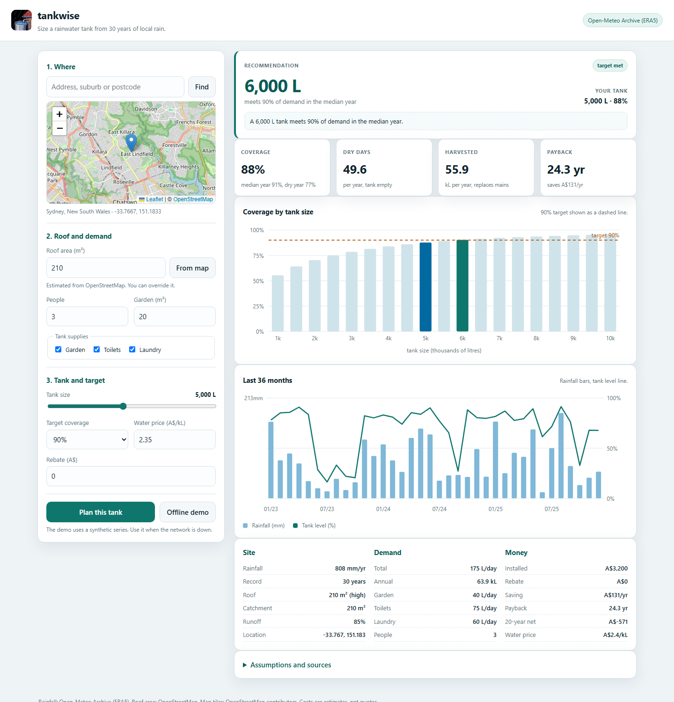
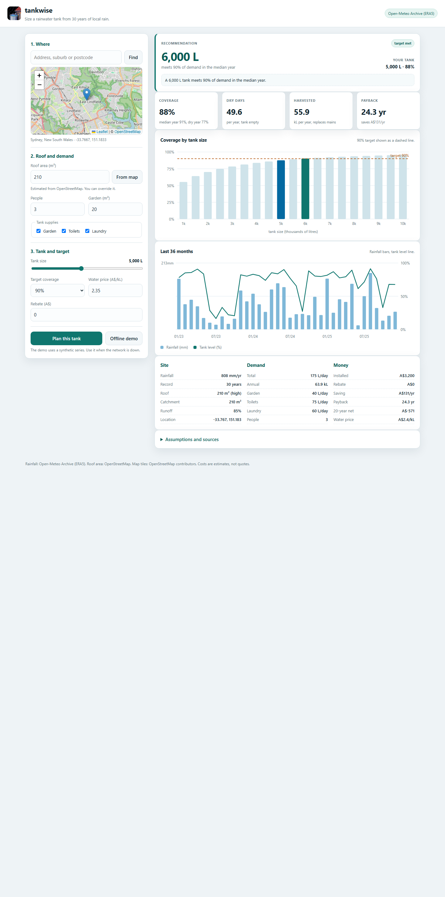

# tankwise

**Size a rainwater tank from 30 years of local rain.**

[](LICENSE)
[](tests/)
[](pyproject.toml)

Most tank buyers guess. A plumber sells a size. tankwise runs a daily water balance
over 30 years of rainfall for one address. It reports the share of demand the tank
meets. It recommends the smallest tank that reaches your target. It estimates payback.

## Features

- **30 years of rain, one address.** Daily rainfall comes from the Open-Meteo Archive.
  No API key is needed.
- **Roof area from the map.** The tool reads building footprints from OpenStreetMap.
  You can override the estimate.
- **Three end uses.** Model garden, toilet and laundry demand with documented rates.
- **Honest reliability.** See coverage, dry days per year, spill and harvested volume.
- **Size sweep.** Compare 19 tank sizes from 1,000 L to 10,000 L on one chart.
- **Payback.** Enter your water price and rebate. The tool returns cost, saving and
  payback years.

## Quick start

```bash
py -3.12 -m venv .venv
.venv\Scripts\activate
pip install -e ".[server]"
uvicorn tankwise.api:app --port 8099
```

Open <http://127.0.0.1:8099>. Search an address. Press **Plan this tank**.

The command line needs no server:

```bash
python -m tankwise.cli --lat -33.7667 --lon 151.1833 --roof 210 --tank 5000
```

Use the synthetic series when you have no network:

```bash
python -m tankwise.cli --demo --tank 5000 --garden 20 --occupants 3
```

Run the tests:

```bash
pip install -e ".[dev]"
pytest
```

## Screenshots



*The recommendation card names the size that meets the target. Tiles show coverage,
dry days, harvested volume and payback.*



*The size sweep and the last 36 months of rainfall and tank level. The lower tables
list site, demand and money facts.*

## How the model works

For each day, the tank adds harvestable rain, spills the excess, then draws demand:

```text
inflow_L = max(0, rain_mm - first_flush_mm) * roof_m2 * runoff_coefficient
level    = min(capacity, level + inflow_L)
spill    = max(0, level - capacity)
met      = min(level, demand_L)
level    = level - met
```

Demand is the sum of the selected end uses:

```text
indoor_L = people * (toilet_L + laundry_L)
garden_L = garden_m2 * seasonal_mm_per_week / 7
```

Garden demand follows the season. It runs from 3 mm per week in winter to 25 mm per
week in summer. The curve flips for the northern hemisphere.

The first 90 days are spin-up and are excluded from the metrics. The starting level
is 25 percent of capacity.

## Data sources

| Source | Use | Cost |
| --- | --- | --- |
| [Open-Meteo Archive](https://open-meteo.com/en/docs/historical-weather-api) | Daily rainfall, ERA5 | Free, no key |
| [Open-Meteo Geocoding](https://open-meteo.com/en/docs/geocoding-api) | Address and postcode search | Free, no key |
| [OpenStreetMap Overpass](https://wiki.openstreetmap.org/wiki/Overpass_API) | Building footprints for roof area | Free, fair use |
| [OpenStreetMap tiles](https://www.openstreetmap.org/copyright) | Map background | Free, attribution required |

SILO from Queensland Long Paddock is a planned second provider. Its data drill needs a
registered key. The provider interface allows that addition.

## Assumptions and limits

- **Rainfall grid.** ERA5 is a global reanalysis on a coarse grid. It can differ from a
  local rain gauge. For the Sydney test point the 1996 to 2025 mean is about 808 mm per
  year. Bureau of Meteorology station averages for the same area are higher.
- **Roof area.** OpenStreetMap coverage varies. The estimate is the largest nearby
  footprint, scaled by 1.15 for roof pitch. Treat it as a starting point.
- **Cost model.** Installed cost is A$900 plus A$0.46 per litre, minus your rebate.
  This is a planning estimate, not a quote. A 5,000 L tank is about A$3,200.
- **Water price.** The default is A$2.35 per kL. This is a usage rate. Service charges
  are excluded.
- **First flush.** The model diverts 1 mm of rain per rain day. Change this in the API
  if your system differs.
- **Scope.** The tool does not design pumps, pressure systems or treatment. It does not
  model stormwater detention credits.
- **No guarantee.** Results are estimates for planning. Confirm the final size with a
  plumber or a tank installer.

## API

| Method | Path | Purpose |
| --- | --- | --- |
| GET | `/api/health` | Status and version |
| GET | `/api/geocode?q=` | Place search |
| POST | `/api/roof` | Roof area estimate for a point |
| POST | `/api/plan` | Full plan for one tank size |

Example:

```bash
curl -X POST http://127.0.0.1:8099/api/plan \
  -H "Content-Type: application/json" \
  -d '{"latitude":-33.7667,"longitude":151.1833,"roof_area_m2":210,"tank_litres":5000}'
```

The response includes `result`, `economics`, `sweep`, `recommendation`, `monthly` and
`assumptions`. Add `"offline_demo": true` to run without the network.

## Project layout

```text
tankwise/       engine, API and CLI
web/            single-page UI and vendored Leaflet
tests/          pytest suite, no network required
docs/           logo and screenshots
SPEC.md         scope, model and acceptance criteria
```

## License

MIT. See [LICENSE](LICENSE).